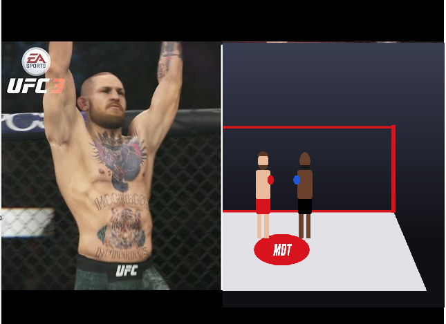

<div align="center">

  <!-- Your custom MMA gloves logo (upload the file as logo.png to the repository root) -->
  

  # 🥊 MDT MMA App

  **A modern Mixed Martial Arts (MMA) desktop game and fight simulator built in Java.**

  <p>
    
    
    
    
  </p>

  <p>
    <a href="#-about-the-game">About</a> •
    <a href="#-gameplay-preview">Gameplay Preview</a> •
    <a href="#-key-features">Key Features</a> •
    <a href="#-installation--setup">Installation</a> •
    <a href="#-repository-structure">Structure</a>
  </p>

</div>

---

## 🥋 About the Game

**MDT MMA App** is a comprehensive desktop application and strategic fight simulator set in the world of professional Mixed Martial Arts. Players step into the octagon, competing in bouts inspired by major global promotions and building their career from local fight nights to championship title shots.

The project combines a clean, classic arena visual style with a custom fight simulation engine written in **Java** and powered by a local **SQL** database.

---

## 📸 Gameplay Preview

<div align="center">
  <!-- Your gameplay screenshot (upload the file as screenshot.png to the repository root) -->
  
  <br />
  <sub><i>Visual inspiration and live octagon bout view in MDT MMA App</i></sub>
</div>

---

## 🔥 Key Features

* **🏟️ MDT Octagon Fight Simulator:** Dynamic one-on-one bouts featuring red and blue corners, stamina management, scoring systems, and knockout mechanics.
* **🏋️ Fighter Progression:** Training system allowing you to develop striking, wrestling, Brazilian Jiu-Jitsu (BJJ), and conditioning stats.
* **📊 SQL Database Integration:** Persistent career progress, fight history, fighter records, and promotion rankings stored via JDBC (`java.sql`).
* **🌐 Multi-Language Support:** Built-in localization support (`EN` / `PL`) using Java Resource Bundles (`.properties`) for seamless UI translation.
* **🖥️ Native Windows Executable (`.exe`):** Ready-to-run distribution package bundled with its own Java Runtime Environment (no manual Java installation required).

---

## 🚀 Installation & Setup

Due to GitHub's 100 MB single-file size limit, the Java runtime `modules` file has been split into smaller chunks (`modules.part1`, `modules.part2`, `modules.part3`).

### Step 1: Clone the repository
```bash
git clone https://github.com
cd MDT
```

### Step 2: Merge the `modules` file
Run the **`zloz_aplikacje.bat`** script located in the root directory (or run the following command in Command Prompt inside the `runtime/lib` folder):
```cmd
copy /b modules.part1 + modules.part2 + modules.part3 modules
```

### Step 3: Launch the game
Once the files are merged, run the **`.exe`** executable located inside the `dist/` directory.

---

## 📂 Repository Structure

```text
MDT/
├── build/               # Temporary build files and compilation assets
├── dist/                # Ready-to-run Windows release (.exe + bundled runtime)
├── src/                 # Application source code (Java, SQL, labels, configs)
├── logo.png             # Red MMA gloves official logo
├── screenshot.png       # In-game octagon preview screenshot
├── ikona.ico            # Primary application icon
├── nowa_ikona.ico       # Updated application icon
├── zloz_aplikacje.bat   # Batch script to merge runtime/lib/modules parts
├── LICENSE              # Mozilla Public License 2.0
└── README.md            # Project documentation
```

---

## 🛠️ Tech Stack

* **Language:** Java (JDK 17+)
* **Database:** JDBC / `java.sql`
* **Configuration:** `.ini`, `.cfg`, and Java `ResourceBundle` (`.properties`)
* **Distribution:** Native Windows `.exe` launcher with embedded JRE

---

## 📄 License

This project is licensed under the **Mozilla Public License 2.0 (MPL-2.0)**. See the [LICENSE](./LICENSE) file for full details.

<div align="center">
  <br />
  <sub>Crafted with passion by <b>mdt-developers</b> 🥊</sub>
</div>

